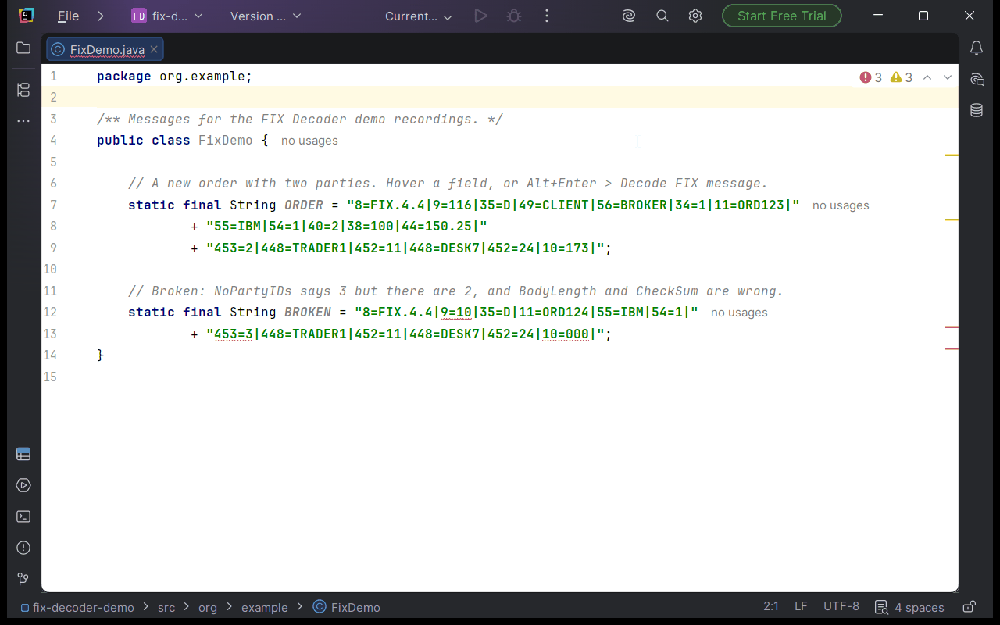

# FIX Decoder

An IntelliJ plugin for FIX protocol messages written in Java code (string literals, text blocks, `+` concatenations) and in plain text files.

## Features




- **Hover**: rest the mouse on a field to see its tag name, type, the meaning of its value (`54=1` is Buy), the other allowed values, its group and instance, and whether the message type requires it. In Java the details appear in IntelliJ's own documentation popup (hover or Ctrl+Q), so there is only one popup; in plain text, and in Java when hover documentation is off, the plugin shows its own popup, which also has a *Decode message* link.
- **Decoder tool window**: *Decode FIX Message* (editor context menu, `Ctrl+Alt+Shift+F`) shows the message at the caret in a tree table with the columns Tag, Name, Value and Meaning. Repeating groups are shown as numbered instances.
  - Clicking a value selects it in the editor; clicking the tag selects the `tag=` part. The focus stays in the table, so you can use the arrow keys.
  - Double-click or Enter moves the focus to the editor.
  - Moving the caret in the editor selects the matching row.
  - The table follows edits to the message. The toolbar can refresh it, copy the message as readable text, decode a message you paste, switch to a flat list (every field in message order, repeating groups not nested), and open the FIX Decoder settings. The search box (Ctrl+F, or your Find shortcut) highlights the fields whose tag, name, value or meaning match, without hiding any rows. Enter or Down jumps to the next match, Shift+Enter or Up to the previous one (F3 and Shift+F3 work from the table too), and Esc clears it. Ctrl+C copies the Value of the selected row. The dictionary drop-down next to the search box decodes the message with FIX 4.2, FIX 4.4 or FIXT 1.1 / FIX 5.0 SP2 whatever its BeginString says (Auto-detect is the default); it changes only the table, not hover or the inspections.
- **Inspections** (Settings | Editor | Inspections | FIX Decoder): every problem is an error, a red underline on the whole field (`tag=value`) it is about. You can lower the level of any of them in the inspection settings.
  - *Repeating group is broken*: the count doesn't match the instances found, an instance doesn't start with the group's first field, a field is out of order or repeated, or an unknown tag ends a group early. Quick fix: *Set count to N*.
  - *BodyLength or CheckSum is wrong*. Quick fix: *Recompute BodyLength and CheckSum*.
  - *Value is not defined for the field*, e.g. `54=Z`.
- **Problem files**: a file with FIX problems gets a red wavy underline on its name in the Project view and on its editor tab, like a file with compile errors. It is marked once it has been opened and analysed.
- **Intentions**:
  - *Convert FIX delimiter to |* and *Convert FIX delimiter to SOH*. In Java, SOH is written as the escape the string already uses (`\u0001` or `\001`).
  - *Add FIX BodyLength and CheckSum*, for messages that have neither.
- **Inline hints** (off by default): value meanings next to the values (`54=1` *Buy*, `35=D` *NewOrderSingle*). Switch them on in Settings | Tools | FIX Decoder.
- **Paste**: pasting a FIX message into a Java file asks whether to paste it as a Java string (SOH as `\u0001`, with quotes added outside a literal) or as it is.
- **Copy FIX Message as Readable**: copies the message with `|` as the delimiter.

Rewrites edit only the characters they change. When part of the message comes from a constant (e.g. `+ SOH +`), any rewrite that would touch that part is not offered.

## Finding messages

A message is either:
- text starting with `8=FIX` that has at least two fields, or
- a fragment of at least three fields, mostly with known tags.

All fields of a message use the same delimiter: SOH, `^A`, `|` or `^`.

In Java, the literal parts of a concatenation are decoded with the literal's own escaping, so positions map back to the source. Constants such as `SOH` are evaluated. Other parts (method calls) show as `…` and switch off the BodyLength and CheckSum checks for that message.

## Dictionaries

The plugin bundles the QuickFIX/J dictionaries for FIX 4.2, FIX 4.4, FIX 5.0 SP2 and FIXT 1.1. The version is chosen from BeginString (8), and from ApplVerID (1128) for FIXT.

Under **Settings | Tools | FIX Decoder** you can:
- add custom QuickFIX/J XML dictionaries. A custom file may contain only the fields and messages it adds, and may refer to fields and components of the standard dictionary. It applies to the version in its `<fix>` element, or to every version when that element has none.
- choose the version for messages without BeginString.
- turn repeating-group validation, BodyLength/CheckSum fixing, inline hints and the paste popup on or off.

## Build

```bash
./gradlew buildPlugin    # plugin zip in build/distributions/
./gradlew runIde         # sandbox IDE with the plugin installed
./gradlew test
./gradlew verifyPlugin   # Plugin Verifier, IDEA 2021.3 to 2026.2
```

The plugin supports IDEA 2021.3 and later. It is compiled to Java 11 bytecode against 2026.1, so Gradle must run on JDK 21 or newer.

## Licence

MIT, see [LICENSE](LICENSE).

This product includes software developed by quickfixengine.org (http://www.quickfixengine.org/). The bundled data dictionaries in `src/main/resources/dictionaries/` come from [QuickFIX/J](https://github.com/quickfix-j/quickfixj) and are used under the QuickFIX Software License, included as `META-INF/QUICKFIX-LICENSE.txt`.
